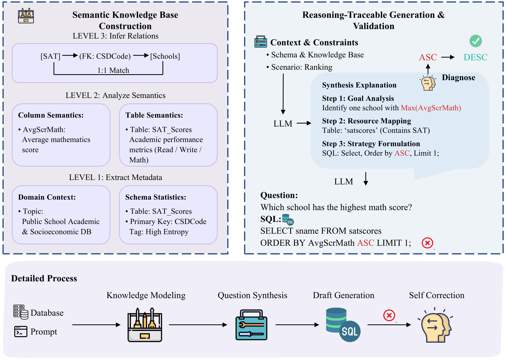

# SemanticAgent: A Semantics-Aware Framework for Text-to-SQL Data Synthesis

<p align="center">
  
</p>

SemanticAgent synthesizes **question–rationale–SQL** training triples whose semantic
correctness is verified before they enter a training set. A layered knowledge base is
constructed from each database's schema and sampled records; generation is guided by
that knowledge through an explicit rationale; and every candidate passes a
diagnose–retrieve–correct verification loop before being admitted. In human evaluation,
synthesized data contains **2.2% semantic errors (vs. 12.4% for OmniSQL)**, and finetuning
on it improves downstream execution accuracy by **3.6–5.0 points** on BIRD with identical
backbones and training budgets.

## Highlights

- **Knowledge-guided synthesis.** A structured knowledge base is progressively
  constructed and reused for both generation and verification:
  `K1` schema · `K2` domain knowledge · `K3` field types · `K4` column semantics ·
  `K5` table semantics · `K6` cross-table relations.
- **Rationale-first generation.** The synthesizer produces a question and an explicit
  rationale — selected tables/columns and their intended operations (join / filter /
  aggregate) — before the SQL, so generation intent is recorded and verifiable.
- **Diagnose–Retrieve–Correct verification.** Candidates are checked by deterministic
  rules (column/join/aggregation validity, predicate **value membership against sampled
  data**) *and* an LLM semantic review; each diagnosis is reviewed against retrieved
  knowledge before targeted correction. Questions are never edited; every correction
  round is appended to the sample's history.
- **Value grounding (V) and rule-based checks (C).** Prompts include sampled database
  values and per-column value domains so generated literals copy real values (including
  dataset quirks) instead of fabricating them; rule-based checks validate schema
  references and predicate values prior to semantic review.
- **Three mutually exclusive terminal states** per candidate: `accepted`,
  `rejected` (unrepairable, e.g. invalid question or data-fact violations), and
  `unresolved` (errors remain after the correction budget). Only `accepted` samples
  enter the training set.
- **Reproducible and resumable synthesis.** Every accepted record keeps its correction
  history and the SQL execution result rows; batch synthesis is incremental
  (per-sample append), resumable, and shards across databases.

## Repository Structure

```text
semantic-agent/
├── app/
│   ├── contracts/       # cross-layer contracts (database/knowledge/candidate/diagnosis/execution/...)
│   ├── ports/           # abstract ports (llm/database/knowledge/records/prompting/parsing)
│   ├── domain/          # pure logic: knowledge builder (K1-K6), candidate generation,
│   │                    #   deterministic verification, evidence routing, correction, admission
│   ├── application/     # use-case orchestration: analysis / synthesis / reflection / batch
│   ├── adapters/        # SQLAlchemy gateway, OpenAI-compatible chat, sqlglot parser,
│   │                    #   JSONL storage, scenario catalog, Jinja prompts, dataset split
│   ├── bootstrap.py     # single composition root
│   └── settings.py      # single configuration entry point
├── configs/             # scenario / operation / complexity YAML
├── prompts/templates/   # Jinja prompt templates (versioned)
├── data/                # benchmark databases (~41GB; see "Data" below)
├── knowledge/snapshots/ # published knowledge snapshots (<benchmark>/<database>/<snapshot_id>/)
├── runs/                # synthesis artifacts (<benchmark>/<database>/<session>/)
├── start_synthesis.sh   # large-scale synthesis launcher (resumable)
└── cli.py               # command-line entry point
```

Dependency direction (enforced by architecture tests): `CLI → application → domain → contracts/ports`;
`adapters → ports + contracts`; `bootstrap` wires everything. The `domain` layer performs no
I/O, reads no environment variables, and creates no clients.

## Setup

- Python 3.12 (only `requirements.txt` is needed; tests use the standard-library `unittest`)
- An OpenAI-compatible chat endpoint. Defaults target a local deployment
  (`SEMANTICSQL_LLM_BASE_URL`, `SEMANTICSQL_LLM_MODEL`); `enable_thinking=false` is
  required for Qwen3-family models and is set by default. `SEMANTICSQL_LLM_FAKE=1`
  injects an offline fake for testing.

```bash
pip install -r requirements.txt
```

## Data

| Content | Size | Availability |
|---|---|---|
| Benchmark databases — Spider 1.0, BIRD, Spider2-SQLite, EHRSQL, ScienceBenchmark | ~41 GB | Alibaba Cloud Drive (`data.tar`; link and extraction code in [`data/README.md`](data/README.md)) |
| Synthesized training corpus (accepted samples with questions, rationales, SQL, correction histories, and execution results) — ~137k samples | — | **Releasing November 2026** on the same cloud drive |
| Knowledge snapshots for all 267 train databases (K1–K6 + measured JOIN profiles) | — | **Releasing November 2026** on the same cloud drive |

Datasets are placed under `data/`; the root can be overridden with `--db-root` or
`SEMANTICSQL_DB_ROOT`. Evaluation databases (dev/test splits) are excluded automatically
to prevent data leakage.

### Data release plan (ToDo)

- [x] Benchmark databases (~41 GB) — available now (Alibaba Cloud Drive, link in [`data/README.md`](data/README.md))
- [ ] **Synthesized training corpus (~137k accepted samples) — releasing November 2026 (Alibaba Cloud Drive)**
- [ ] Knowledge snapshots for all 267 train databases (K1–K6 + measured JOIN profiles) — releasing November 2026 (same cloud drive)

## Usage

```bash
# 1) Knowledge construction (parallel across databases; already-built snapshots are skipped)
python cli.py list-dbs -b spider                    # list synthesizable train databases
python cli.py build-knowledge -b bird -w 20         # K1-K6 knowledge snapshots
python cli.py profile-kb -b bird -w 8               # measured JOIN profiles (sidecar)

# 2) Synthesis (generation + verification; resumable, evenly distributed over databases)
python cli.py run-benchmark -b bird --total 30000 -w 20
python cli.py run -b spider -d aan_1 -n 100 -w 20   # single database
```

## Training Data Format

Only `accepted` samples are emitted, one JSON object per line
(`runs/<benchmark>/<database>/<session>/training.accepted.jsonl`):

```json
{
  "question_id": "q-...",
  "question": "...",
  "think": {
    "focus": "...",
    "metadata": {"main_scenario": "...", "complexity_level": 2, "...": "..."},
    "table_selection": {"tables_used": ["..."], "reasoning": "..."},
    "column_selection": {"columns_used": [{"name": "...", "operation": "WHERE", "purpose": "..."}]},
    "sql_strategy": {"operations": ["SELECT", "JOIN", "LIMIT"], "approach": "...", "no_need": ["..."]},
    "expected_output": "..."
  },
  "answer": "SELECT ...",
  "correction_history": [
    {"iteration": 1, "errors_addressed": ["..."], "sql_before": "...", "sql_after": "...", "summary": "..."}
  ],
  "execution": {
    "executed": true, "execution_success": true, "result_count": 26,
    "result_columns": ["..."], "result_rows": ["..."], "result_rows_truncated": true
  }
}
```

## Citation

```bibtex
@article{semanticagent2026,
  title   = {SemanticAgent: A Semantics-Aware Framework for Text-to-SQL Data Synthesis},
  author  = {Anonymous Authors},
  journal = {IEEE Transactions on Knowledge and Data Engineering (under review)},
  year    = {2026}
}
```

## Contact

For questions about the code or the released data, please open an issue in this repository.
